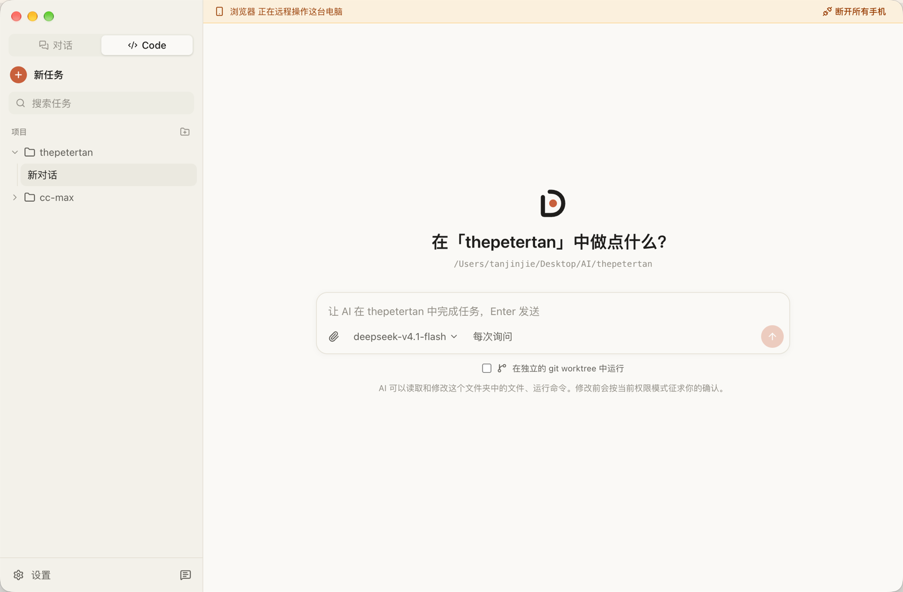
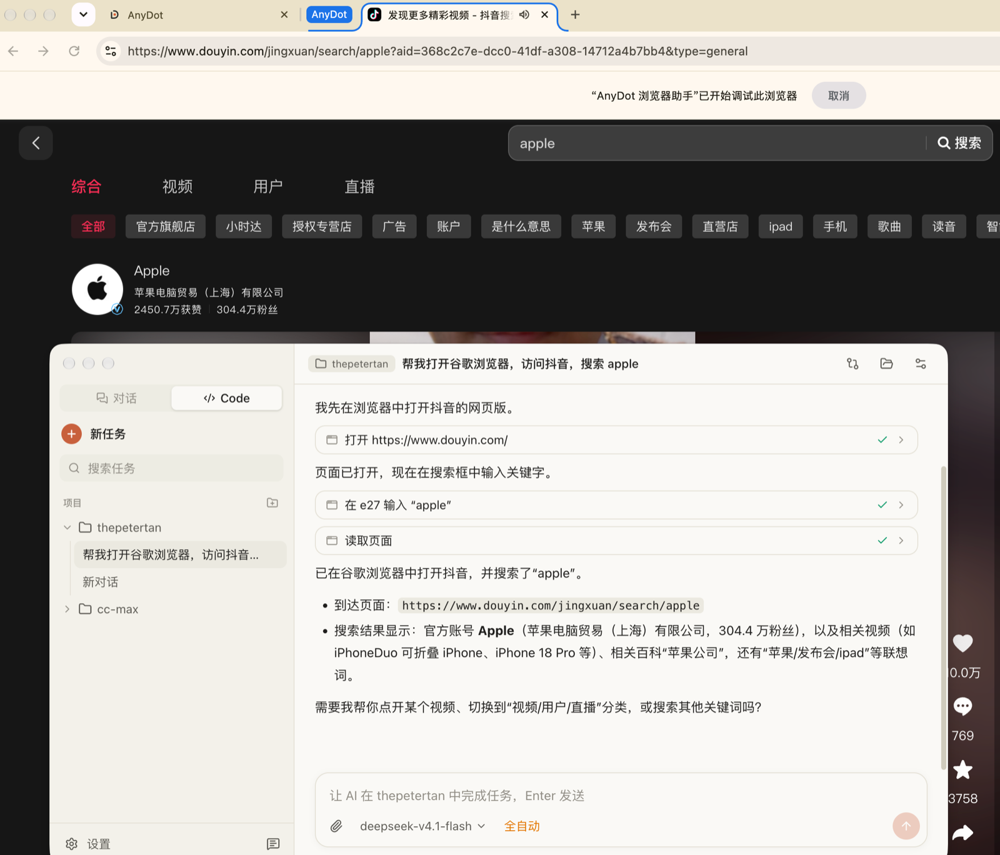

# AnyDot

开源的 AI 桌面客户端 + 手机端。填入 `base_url + key` 就能用 GPT、Claude、gpt-image 和视频模型；桌面端可以像 Claude 桌面端一样在项目里写代码、跑命令；手机扫码配对后可以远程派任务、确认操作。

- **对话**：Claude / GPT 流式输出、深度思考、附件（图片 / PDF / 文本）、分支（编辑和重新生成）、搜索
- **生图 / 视频**：gpt-image 生成与编辑（参考图）、视频模型（重启后继续）
- **Agent**：项目文件夹、读写文件、搜索、终端命令、网页抓取、生图、任务列表、MCP 工具、Skills 与斜杠命令、`@` 引用文件、子 Agent、向你提问、Hooks、git worktree 与改动面板、定时任务、Artifacts 侧栏；四种权限模式，危险操作始终确认；长任务自动压缩上下文
- **手机连接**：扫码配对、端到端加密、远程派任务和审批、推送通知；手机也可以直接对话和生图
- **数据只在本地**：SQLite + 内容寻址的文件存储，支持导出 / 导入；API Key 用系统钥匙串加密

[](https://anydot.app/videos/anydot-intro.mp4)

<p align="center">▶ 点击上图观看 1 分钟介绍视频：写代码、操作电脑、生成视频、控制电视，手机一键确认</p>





设计文档：[docs/PLAN.md](docs/PLAN.md) · 中继部署：[docs/DEPLOY.md](docs/DEPLOY.md)

## 安装

到官网 [anydot.app](https://anydot.app) 或 [Releases](https://github.com/JinJieTan/anydot/releases) 下载对应系统的安装包：

| 系统                            | 文件                                    |
| ------------------------------- | --------------------------------------- |
| macOS（Apple 芯片 M1/M2/M3/M4） | `AnyDot-版本号-mac-arm64.dmg`           |
| macOS（Intel 芯片）             | `AnyDot-版本号-mac-x64.dmg`             |
| Windows（绝大多数电脑）         | `AnyDot-版本号-windows-x64-setup.exe`   |
| Windows（ARM 设备）             | `AnyDot-版本号-windows-arm64-setup.exe` |

安装包没有使用付费的开发者证书签名，所以第一次打开时系统会拦一下，按下面操作一次即可，以后正常打开。

**macOS**

1. 打开 dmg，把 AnyDot 拖到“应用程序”。
2. 双击打开，系统提示“无法验证开发者”或“Apple 无法检查其是否包含恶意软件”时，点“完成”或“取消”。
3. 打开“系统设置 → 隐私与安全性”，在页面下方找到 AnyDot，点“仍要打开”，输入开机密码确认。

如果提示“已损坏，无法打开”，在“终端”里运行下面这条命令后再打开：

```bash
xattr -cr /Applications/AnyDot.app
```

**Windows**

运行安装程序时如果出现“Windows 已保护你的电脑”，点“更多信息 → 仍要运行”。

**更新与已知限制**

- 目前没有自动更新，新版本需要到 Releases 下载后覆盖安装。数据保存在用户目录，覆盖安装不会丢失。
- macOS 上更新后，系统可能会再次询问是否允许 AnyDot 使用钥匙串（输入开机密码，点“始终允许”）；用到“电脑操作”功能的话，可能需要在“隐私与安全性”里重新勾选辅助功能和录屏权限。这是没有付费签名的应用在 macOS 上的正常现象。
- 出现问题时，在“设置 → 关于”里点“打开日志文件夹”，把 `main.log` 附在 issue 里（日志会自动隐去 API Key）。

## 开发

需要 Node.js 24+ 和 pnpm 10+。

```bash
pnpm install
pnpm dev
```

国内网络下载 Electron 较慢时，可以设置镜像：

```bash
export ELECTRON_MIRROR=https://npmmirror.com/mirrors/electron/
```

### 没有 Key 也能试

仓库自带一个本地模拟网关，支持 Anthropic / OpenAI Responses / Chat Completions、生图和视频接口：

```bash
pnpm --filter @aitech/core mock
```

在桌面端添加服务商，Base URL 填它打印的地址，Key 填 `sk-test`。在项目里发任务会走一段脚本化的 Agent 流程（任务列表 → 查找文件 → 运行命令，需要确认）。

### 用独立的数据目录调试

```bash
AITECH_USER_DATA=/tmp/aitech-dev pnpm dev
```

### 手机端

```bash
pnpm --filter @aitech/relay build
pnpm --filter @aitech/mobile build
MOBILE_DIR=apps/mobile/dist PUBLIC_URL=http://<电脑局域网 IP>:8090 node apps/relay/dist/server.mjs
```

桌面端 设置 → 手机连接，中继地址填 `http://<电脑局域网 IP>:8090`，然后“绑定手机”扫码。
（推送通知和离线缓存需要 HTTPS，正式使用请按 [docs/DEPLOY.md](docs/DEPLOY.md) 部署。）

## 常用命令

| 命令                                                      | 说明                 |
| --------------------------------------------------------- | -------------------- |
| `pnpm dev`                                                | 启动桌面端（热更新） |
| `pnpm test`                                               | 全部单元 / 集成测试  |
| `pnpm typecheck`                                          | 类型检查             |
| `pnpm lint` / `pnpm format`                               | 代码检查 / 格式化    |
| `pnpm --filter @aitech/desktop dist:mac`                  | 打包 macOS（dmg）    |
| `pnpm --filter @aitech/desktop dist:mac:unsigned`         | 打包 macOS（未签名） |
| `pnpm --filter @aitech/desktop dist:win`                  | 打包 Windows（nsis） |
| `docker build -f apps/relay/Dockerfile -t aitech-relay .` | 中继 + 手机网页镜像  |

## 目录结构

```
apps/desktop       Electron 桌面端（main / preload / renderer / agent 进程）
apps/mobile        手机端 PWA（React + Vite），由中继托管在 /m/
apps/relay         中继服务（Node，打包为单个文件）
packages/core      模型适配（Claude / GPT）、生图、视频、模拟网关
packages/agent     Agent 循环、工具、权限策略、MCP
packages/db        本地 SQLite schema、迁移与数据访问
packages/protocol  设备身份、端到端加密、配对与中继协议（桌面 / 手机 / 中继共用）
docs/              设计与部署文档
```

## 发布

更新版本号无需改代码：推送一个 `v` 开头的标签即可。GitHub Actions 会在 macOS 和 Windows 上跑测试、打包，并创建一个**草稿** Release，检查无误后在 GitHub 上点“发布”。

```bash
git tag v0.1.0
git push origin v0.1.0
```

## 许可证

[MIT](LICENSE)
